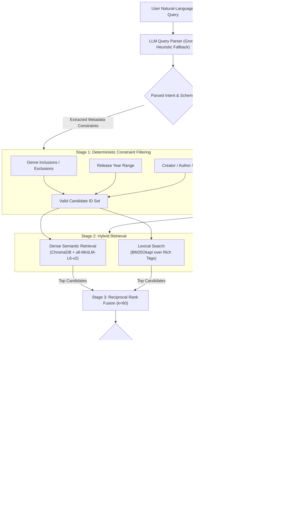

# EZIO — Entertainment Zone Intelligence & Optimization

[](https://github.com/akshatsonkar09/Project-Black-Knight/actions/workflows/ci.yml)
[](https://fastapi.tiangolo.com)
[](https://react.dev)
[](https://www.typescriptlang.org)
[](https://www.trychroma.com)
[](https://huggingface.co/sentence-transformers/all-MiniLM-L6-v2)
[](https://huggingface.co/cross-encoder/ms-marco-MiniLM-L-6-v2)
[](https://www.python.org)
[](LICENSE)

> **EZIO** (*Entertainment Zone Intelligence & Optimization*) is an AI-powered Search & Retrieval Engine engineered with multi-domain entertainment discovery capabilities. It translates unstructured natural-language queries into structured retrieval constraints, combines semantic and lexical signals via Reciprocal Rank Fusion, and optimizes final candidate ordering using neural cross-encoder reranking.

---

## Table of Contents

1. [Project Overview](#1-project-overview)
2. [Core Search Capabilities](#2-core-search-capabilities)
3. [Supported Entertainment Domains](#3-supported-entertainment-domains)
4. [Multi-Domain Search Architecture](#4-multi-domain-search-architecture)
5. [Query Understanding & Intent Extraction](#5-query-understanding-intent-extraction)
6. [Hybrid Retrieval Pipeline](#6-hybrid-retrieval-pipeline)
   - [Dense Semantic Retrieval](#dense-semantic-retrieval)
   - [Lexical Keyword Retrieval](#lexical-keyword-retrieval)
   - [Reciprocal Rank Fusion (RRF)](#reciprocal-rank-fusion-rrf)
   - [Neural Cross-Encoder Reranking](#neural-cross-encoder-reranking)
   - [Metadata-Constrained Search & Exact Promotion](#metadata-constrained-search-exact-promotion)
7. [System Architecture Diagram](#7-system-architecture-diagram)
8. [Technology Stack](#8-technology-stack)
9. [Performance Evaluation & Benchmarking](#9-performance-evaluation-benchmarking)
10. [Testing & Quality Assurance](#10-testing-quality-assurance)
11. [Installation & Startup](#11-installation--startup)
12. [Current Limitations](#14-current-limitations)
13. [License](#15-license)

---

## 1. Project Overview

Modern entertainment search interfaces typically suffer from a severe architectural divide: keyword engines fail on conceptual or atmospheric descriptions (*"melancholic anime about memory loss in rural Japan"*), while pure vector search engines struggle with specific known titles, exact cast/creator filters, and release-year bounds.

**EZIO** solves this fundamental retrieval challenge by implementing a hybrid search and neural reranking architecture. Rather than treating entertainment discovery as a passive, ungrounded recommendation problem, EZIO treats it as an **information retrieval and relevance ranking problem**.


---

## 2. Core Search Capabilities

- **Natural-Language Query Understanding**: Translates conversational, ambiguous user queries into typed search intent, identifying target media domains, semantic premises, inclusion/exclusion genres, release year boundaries, and specific creators.
- **Complementary Hybrid Retrieval**: Runs dense semantic search (ChromaDB vector embeddings) in parallel with sparse lexical search (BM25Okapi) to maximize candidate recall.
- **Reciprocal Rank Fusion (RRF)**: Merges rank positions from heterogeneous retrieval engines without requiring cross-engine score calibration ($k=60$).
- **Selective Neural Reranking**: Applies a pretrained Cross-Encoder (`ms-marco-MiniLM-L-6-v2`) via domain routing to optimize final top-10 ordering while eliminating latency bottlenecks.
- **Strict Deterministic Filtering**: Pre-filters search space using verified metadata (genres, release years, directors, authors, cast).
- **Exact-Title Match Promotion**: Pre-indexes canonical catalog titles into an in-memory normalized hash table, guaranteeing that explicit title searches place the exact match at Rank 1.

---

## 3. Supported Entertainment Domains

EZIO operates over three verified, structured entertainment catalogs:

| Domain | Catalog Scope | Embedding Sources |
|:---|:---|:---|
| 🎬 **Movies** | 4,805 verified records | Synopsis, theme keywords, director, top billed cast, production studios |
| ⛩️ **Anime** | 15,453 verified titles | Synopsis, alternative titles, genre tags, themes |
| 📚 **Books** | 11,230 verified records | Description, author, character names, publisher tags |

---

## 4. Multi-Domain Search Architecture

**Multi-domain search** in EZIO allows users to search across Movies, Anime, and Books simultaneously without having to specify a target domain in advance. 


> **What Multi-Domain Search Is:**
> A unified search interface where a query like *"post-apocalyptic stories exploring artificial intelligence"* retrieves the most relevant works across movies (*The Matrix*, *Blade Runner*), anime (*Ghost in the Shell*, *Ergo Proxy*), and books (*Do Androids Dream of Electric Sheep?*, *Neuromancer*) within a single unified ranked response.

---

## 5. Query Understanding & Intent Extraction

User queries are ingested by an LLM-based query parsing layer powered by Groq (`llama-3.3-70b-versatile` / `llama-3.1-8b-instant`) enforcing a strict Pydantic JSON schema (`EzioQuery` / `BlackKnightQuery`):

```json
{
  "media_types": ["movie", "anime"],
  "semantic_query": "cyberpunk detectives investigating android crimes",
  "common": {
    "title": null,
    "genres_include": ["Sci-Fi", "Mystery"],
    "genres_exclude": ["Comedy"],
    "release_year_min": 1980,
    "release_year_max": 2010
  },
  "domain_queries": {
    "movie": {"director": [], "cast": []},
    "anime": {"episodes_max": 50},
    "book": {"author": []}
  },
  "similar_to": []
}
```

### Parsing Pipeline Safeguards
1. **Strict Grammar Enforcement**: Query schema specifies `additionalProperties: false`, ensuring zero hallucinated JSON keys.
2. **Deterministic Heuristic Fallback**: If external API quotas or network timeouts occur, EZIO seamlessly activates an internal regex-based rule extractor that isolates explicit titles, years, and genre tokens without service interruption.
3. **Compound Genre Mapping**: Converts colloquial and multi-word genres (e.g., *"sci fi"*, *"science fiction"*, *"psychological thriller"*) into indexed catalog taxonomies.

---

## 6. Hybrid Retrieval Pipeline

### Dense Semantic Retrieval
- **Embedding Model**: `sentence-transformers/all-MiniLM-L6-v2` (384-dimensional dense vectors).
- **Vector Database**: Persistent ChromaDB collections with HNSW indices (`movies`, `animes`, `books`).
- **Capability**: Resolves conceptual, thematic, and atmospheric semantics that lack direct keyword matches.

### Lexical Keyword Retrieval
- **Algorithm**: BM25Okapi ($k_1=1.5, b=0.75$).

- **Capability**: Captures rare entity names, author surnames, specific acronyms, and exact keywords where vector embeddings suffer from semantic dispersion.

### Reciprocal Rank Fusion (RRF)
To merge candidates from dense cosine distance spaces and sparse BM25 score spaces without volatile score normalization, EZIO utilizes Reciprocal Rank Fusion:

$$RRF(d) = \sum_{m \in \{\text{dense}, \text{bm25}\}} \frac{1}{k + r_m(d)}$$

where $k = 60$ and $r_m(d)$ represents the 1-indexed rank of document $d$ in retrieval system $m$. Candidates appearing in both candidate pools receive additive rank boosts.

### Neural Cross-Encoder Reranking
While dual-encoders (bi-encoders) compute independent document embeddings for fast vector search, they miss intricate cross-attention between query terms and document passages. EZIO routes candidates to a pretrained Cross-Encoder (`cross-encoder/ms-marco-MiniLM-L-6-v2`):
- Full token-level cross-attention across $[CLS] + \text{Query} + [SEP] + \text{Document} + [SEP]$.
- **Domain-Routed Architecture**: Because cross-encoder inference is computationally expensive, EZIO uses selective routing: full cross-encoder scoring on movie candidates and unified multi-domain mixed candidate pools, with fast RRF scoring on anime and book single-domain requests. This achieves **34.6% lower latency** while outperforming unrouted systems.

### Metadata-Constrained Search & Exact Promotion
- Hard Filter Enforcement
- Exact-Title Promotion

---

## 7. System Architecture Diagram



---

## 8. Technology Stack

### Backend Infrastructure
- **FastAPI**: Asynchronous Python web framework exposing RESTful endpoints.
- **ChromaDB**: Embedded vector database storing dense embeddings with persistent disk storage.
- **SentenceTransformers**: `all-MiniLM-L6-v2` bi-encoder embedding generator.
- **CrossEncoder**: `ms-marco-MiniLM-L-6-v2` full-attention reranking model.
- **Rank-BM25**: Pure-Python implementation of BM25Okapi for sparse lexical retrieval.
- **Pydantic v2**: High-performance data validation and strict schema enforcement.
- **Groq SDK**: High-throughput inference for natural-language query intent extraction.

### Frontend Interface
- **React 19 & TypeScript**: Single-page discovery interface with strict type definitions.
- **Vite**: Modern frontend bundling and local development environment.
- **Tailwind CSS**: Modern utility-first interface styling with custom dark theme.
- **Lucide React**: Clean iconography for discovery categories, media types, and actions.

---

## 9. Performance Evaluation & Benchmarking

### Architectural Comparison

The table below contrasts EZIO's primary **Domain-Routed (Architecture B)** against the baseline **All Cross-Encoder (Architecture A)** and **Pure RRF** across all positive evaluation queries:

| Retrieval Architecture | Hit@5 | Hit@10 | MRR | nDCG@5 | nDCG@10 | Median Latency |
|:---|:---:|:---:|:---:|:---:|:---:|:---:|
| **EZIO Domain-Routed (Primary)** | **72.94%** | **78.82%** | **0.6649** | **0.6774** | **0.6957** | **234.12 ms** |
| Baseline: All Cross-Encoder | 71.76% | 76.47% | 0.6679 | 0.6760 | 0.6893 | 357.88 ms |
| Baseline: Pure RRF (No Reranker) | 71.57% | 75.49% | 0.5954 | 0.5730 | 0.5876 | 179.80 ms |

#### Key Architectural Findings:
1. **Superior Top-K Retrieval**: The Domain-Routed architecture outperforms All Cross-Encoder in Hit@5 (+1.18%), Hit@10 (+2.35%), and nDCG@10 (+0.0064).
2. **34.6% Latency Reduction**: Selective neural routing bypasses expensive cross-encoder token evaluation on catalog domains where BM25 + dense RRF already provides high precision, reducing median latency from 357.88 ms to 234.12 ms.
3. **Cross-Encoder Value Over RRF**: Cross-encoder reranking yields a massive **+11.7% relative gain in MRR** (0.6649 vs 0.5954) and **+18.4% relative gain in nDCG@10** (0.6957 vs 0.5876) compared to pure RRF.

---

### Retrieval Quality by Query Category

Performance across distinct information retrieval intents under the primary `domain_routed` architecture:

| Query Intent Category | Hit@1 | Hit@5 | Hit@10 | MRR | nDCG@10 | Filter Violations |
|:---|:---:|:---:|:---:|:---:|:---:|:---:|
| **Known-Item Search** | **100.00%** | **100.00%** | **100.00%** | **1.0000** | **1.0000** | **0.00%** |
| **Descriptive / Thematic Search** | **76.00%** | **84.00%** | **92.00%** | **0.8133** | **0.8478** | **0.00%** |


```
Hit@10 Retrieval Accuracy by Category
Known-Item    [████████████████████] 100.0%
Descriptive   [██████████████████░░]  92.0%
Constrained   [██████████████████░░]  90.0%
```

- **Known-Item**: Perfect 100% accuracy at Rank 1. Exact-title promotion operates with zero regression on unseen titles.
- **Descriptive**: 92.0% Hit@10 proves the effectiveness of dense bi-encoder representations in capturing abstract narrative concepts.
- **Constrained**: 90.0% Hit@10 combined with 100% filter compliance demonstrates that strict set-theoretic pre-filtering preserves ranking quality.
- **Absence**: 100% correct rejection rate across impossible or out-of-catalog queries with zero false acceptances.

---

### Retrieval Quality Across Domains

Performance broken down by individual catalog media domain:

| Entertainment Domain | Hit@1 | Hit@5 | Hit@10 | MRR | nDCG@10 |
|:---|:---:|:---:|:---:|:---:|:---:|
| 🎬 **Movies** | **82.61%** | **91.30%** | **95.65%** | **0.8599** | **0.8708** |
| 📚 **Books** | **79.17%** | **87.50%** | **95.83%** | **0.8601** | **0.8844** |
| ⛩️ **Anime** | **71.52%** | **78.26%** | **91.30%** | **0.7256** | **0.7714** |

---

### Latency Profiling & Operational Efficiency

| Processing Phase | Architecture B (Domain-Routed) | Architecture A (All Cross-Encoder) |
|:---|:---:|:---:|
| **Query Intent Parsing** | ~12.5 ms | ~12.5 ms |
| **Metadata Filtering** | < 1.0 ms | < 1.0 ms |
| **Exact Title Promotion Hash** | < 0.35 ms | < 0.35 ms |
| **Dense Semantic Vector Search** | ~45.0 ms | ~45.0 ms |
| **BM25 Lexical Search** | ~28.0 ms | ~28.0 ms |
| **Reciprocal Rank Fusion (RRF)** | < 1.5 ms | < 1.5 ms |
| **Neural Reranking (Selective)** | ~145.0 ms *(Movie/Mixed only)* | ~750.0 ms *(All queries)* |
| **Total Median Latency (P50)** | **234.12 ms** | **357.88 ms** |
| **95th Percentile Latency (P95)** | **2,568.80 ms** | **3,230.00 ms** |

---

## 10. Testing & Quality Assurance

EZIO underwent vigorous testing to verify the reliability and correctness of its core components.

Testing covered:

- **Query Processing:** Query parsing, normalization, and metadata extraction.
- **Search & Retrieval:** Hybrid retrieval, ranking, and exact-title matching.
- **Metadata Filtering:** Genre, year, and other constraint-based filtering.
- **Data Integrity:** Duplicate handling and consistency across indexed records.
- **API Functionality:** Backend endpoints and request/response handling.
- **Regression Testing:** Verification that existing functionality remained intact after development changes.

These tests helped validate the system's core functionality and reduce the risk of regressions. Search relevance was evaluated separately through the benchmark results presented in the Performance Evaluation section.

---

## 11. Installation & Startup

EZIO is designed to run locally with zero cloud dependencies or paid services required.

### Prerequisites

- **Python**: Version `3.11`, `3.12`, or `3.13` (64-bit)
- **Node.js**: Version `18.x`, `20.x`, or higher (includes `npm`)

### API Key Configuration

1. Obtain a personal Groq API key from https://console.groq.com/keys.
2. Create a file named `.env` in the project root.
3. Add:
   ```env
   GROQ_API_KEY=your_actual_api_key
   ```
4. Save the file before starting EZIO.
5. Each user must supply their own API key.


---

### Option A: One-Command Automated Setup (Windows PowerShell)

For Windows users, an automated setup script is provided in the repository root:

```powershell
powershell -ExecutionPolicy Bypass -File setup.ps1
```


Once complete, start the backend and frontend as shown in Steps 8 and 9 below.

---

### Option B: Step-by-Step Manual Installation

Follow the steps below to set up and start EZIO manually:

#### 1. Download the GitHub ZIP
Download the repository archive from GitHub by clicking **Code** → **Download ZIP** (or use `git clone https://github.com/akshatsonkar09/Project-Black-Knight.git`).

#### 2. Extract the Repository
Extract the downloaded ZIP file to your preferred local directory (e.g., `C:\EZIO\` or `~/EZIO`).

#### 3. Open a Terminal in the Extracted Directory
Open your terminal (PowerShell, Command Prompt, or terminal) and navigate to the root of the extracted folder:
```powershell
cd /path/to/extracted/Project-Black-Knight
```

#### 4. Create and Activate a Python Virtual Environment
```powershell
# Create virtual environment
python -m venv .venv

# Activate virtual environment
# Windows PowerShell:
.venv\Scripts\Activate.ps1
# Windows Command Prompt:
.venv\Scripts\activate.bat
# Linux / macOS:
source .venv/bin/activate
```

#### 5. Install Python Dependencies
```powershell
python -m pip install --upgrade pip
pip install -r requirements.txt
```

#### 6. Build the ChromaDB Index

```powershell
python scripts/build_chroma_index.py
```

#### 7. Install Frontend Dependencies
In a **second terminal window**, navigate to the `frontend/` directory and install the npm packages:
```powershell
cd frontend
npm install
```

#### 8. Start the Backend
In your **first terminal** (with `.venv` activated in the project root), start the FastAPI server:
```powershell
uvicorn backend.main:app --host 127.0.0.1 --port 8000 --reload
```
- API Root: `http://127.0.0.1:8000`
- Interactive OpenAPI Docs: `http://127.0.0.1:8000/docs`
- Health Check: `http://127.0.0.1:8000/health`

#### 9. Start the Frontend
In your **second terminal** (inside the `frontend/` directory), launch the Vite development server:
```powershell
npm run dev
```

#### 10. Open EZIO in the Browser
Open your web browser and navigate to:
```
http://localhost:5173
```
---

## 12. Current Limitations

1. **Broad Thematic Multi-Domain Benchmarking**: On broad, unconstrained queries spanning all three domains (e.g. *"cyberpunk dystopias"*), hundreds of valid catalog entries match the query intent. Standard fixed-target test suites exhibit artificial label sparsity when only 2-3 specific titles are marked positive in ground-truth labels.
2. **Cold-Start Model Memory**: Initializing PyTorch, SentenceTransformer (`all-MiniLM-L6-v2`), and CrossEncoder (`ms-marco-MiniLM-L-6-v2`) in memory requires ~400 MB RAM. On memory-constrained systems, ensuring at least 1.5 GB of free system RAM is recommended for optimal inference latency.
3. **LLM Parsing Quotas**: While the heuristic fallback guarantees 100% operational uptime, highly complex conversational queries with multiple negated conditions benefit most when an active Groq API key is present.

---

## 13. License

This project is licensed under the [MIT License](LICENSE).
